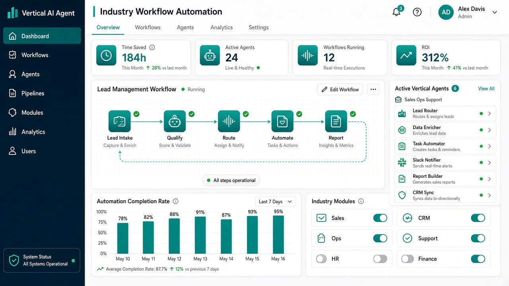

# Vertical AI Agent (Industry-Specific Workflow Automation)



**Enterprise vertical AI agent platform for industry-specific workflow automation, modular ops, and measurable time savings across sales, ops, and support.**

[](https://laravel.com)
[](https://filamentphp.com)
[](https://www.php.net)
[](./docker-compose.yml)
[](https://imrandev.bd)

> SEO keywords: vertical AI agent, industry workflow automation, modular operations platform, sales ops support automation, AI agent orchestration, measurable time savings ROI, Laravel Filament enterprise automation, cross-industry AI workflows, enable disable business modules, multi-role automation admin.

---

## Why Vertical AI Agent?

Most “AI tools” dump a chatbot into a ticket queue and call it transformation. **Vertical AI Agent** is a complete business operating system for automation: industry verticals, toggleable modules, workflow graphs, specialized agents, pipelines, and an ROI ledger that converts minutes saved into executive-grade outcomes.

Built for operators who need to answer:

- Which modules should we turn on for *our* industry?
- How many hours did automation return this week?
- Which agent / workflow is failing SLA?
- Can sales, ops, and support share one control plane without forcing unused features?

Accent theme: **`#0F766E`** (teal) — production Filament admin + public marketing site.

---

## Product Snapshot

| Capability | What you get |
|---|---|
| Modular runtime | Enable/disable 12 business modules (core modules protected) |
| Multi-role IAM | Super Admin, Admin, Manager, Staff, Client, Demo |
| Vertical playbooks | Cross-industry, retail, services, healthcare, finance |
| Workflow engine | Steps, triggers, dispatch service, run history |
| Vertical agents | Specialty AI workers bound to workflows & models |
| Pipelines | Stage-based ops routing with in-flight counters |
| ROI analytics | Hours, tasks, cost saved, ROI % widgets |
| Public pages | Home, Features, Modules, Workflows, Agents, Pricing, Demo |
| Filament admin | Full CRUD resources + teal dashboard stats |
| Packagist stack | drutogoti, admin-panel, ai-hub, ai-catalog, attendance-hub, unicode-pdf, universal-slug |

---

## Live Demo Credentials

After `php artisan migrate --seed`:

| Role | Email | Password |
|---|---|---|
| **Demo** | `demo@vertical-ai.test` | `password` |
| Super Admin | `admin@vertical-ai.test` | `password` |
| Admin | `ops-admin@vertical-ai.test` | `password` |
| Manager | `manager@vertical-ai.test` | `password` |
| Staff | `staff@vertical-ai.test` | `password` |
| Client | `client@vertical-ai.test` | `password` |

Admin panel: `/admin` · Marketing: `/` `/features` `/modules` `/workflows` `/agents` `/pricing` `/demo`

---

## Business ROI & Time-Saver Opportunities

### Executive outcomes
- **Compress cycle time** from lead intake → qualified opportunity with Sales Automation + Vertical Agents.
- **Deflect Tier-1 support** using Support Copilot workflows with measurable minutes saved per ticket.
- **Stabilize ops exceptions** via Ops Orchestration escalation graphs instead of Slack archaeology.
- **Prove value weekly** with Time Saving Metrics (hours, tasks, estimated cost) and ROI % vs platform cost.
- **Right-size footprint** by disabling unused modules (compliance, attendance, catalog scrape) without redeploying.

### Department time-savers
| Department | Opportunity | Typical weekly hours unlocked (seed model) |
|---|---|---|
| Sales | Auto qualify + route leads | ~28h |
| Operations | Exception orchestration & routing | ~36h |
| Support | Triage + draft replies | ~32h |
| HR | Day-one onboarding packs | ~18h |
| Finance | Ledger match / reconcile | ~22h |
| Reporting | Multilingual Unicode PDF packs | ~10h |
| Data | AI catalog scrape & normalize | ~16h |

**Compounding effect:** when modules stay enabled, the platform estimates **100+ hours/week** of automation capacity in the demo seed — the dashboard then records actuals from automation runs.

### Opportunity backlog for implementers
1. Connect webhook triggers from CRM / helpdesk into `WorkflowAutomationService::dispatch()`.
2. Route model calls through `imrandevbd/laravel-ai-hub` per agent specialty.
3. Generate client-facing multilingual run reports with `laravel-unicode-pdf`.
4. Sync workforce clocks via `laravel-attendance-hub` for field + HQ hybrids.
5. Enrich product/service catalogs with `laravel-ai-catalog` for retail verticals.
6. Accelerate page delivery with `drutogoti` performance helpers.
7. Extend Filament surfaces using `laravel-admin-panel` patterns.
8. Keep SEO-safe multilingual slugs with `laravel-universal-slug`.

---

## Modules (On / Off)

Every module is a first-class record (`modules` table) with `is_enabled`, `is_core`, category, and estimated weekly hours.

| Key | Name | Category | Core |
|---|---|---|---|
| `sales_automation` | Sales Automation | sales | Yes |
| `ops_orchestration` | Ops Orchestration | operations | Yes |
| `support_copilot` | Support Copilot | support | No |
| `hr_onboarding` | HR Onboarding Agent | hr | No |
| `finance_reconcile` | Finance Reconciliation | finance | No |
| `compliance_audit` | Compliance Audit Trail | compliance | No |
| `knowledge_rag` | Knowledge RAG Hub | knowledge | No |
| `attendance_bridge` | Attendance Machine Bridge | workforce | No |
| `pdf_reporting` | Unicode PDF Reporting | reporting | No |
| `catalog_scrape` | AI Catalog Scraper | data | No |
| `pipeline_routing` | Pipeline Smart Routing | operations | No |
| `roi_analytics` | ROI & Time Analytics | analytics | Yes |

`ModuleRegistry` caches lookups, blocks disabling core modules, and feeds marketing + dashboard KPIs.

---

## Domain Model

- **Users** — roles via `UserRole` enum; Filament access gated by role.
- **IndustryVertical** — playbooks & default module packs.
- **Module** — feature flags for the business.
- **Workflow** + **WorkflowStep** — graph definition & timing estimates.
- **VerticalAgent** — AI worker with provider/model/success metrics.
- **Pipeline** — stage routing containers.
- **AutomationRun** — execution ledger.
- **TimeSavingMetric** — daily ROI facts.

Services: `ModuleRegistry`, `WorkflowAutomationService`, `RoiCalculator`.  
Policies: `ModulePolicy`, `WorkflowPolicy`, `VerticalAgentPolicy`.

---

## Filament Admin Resources

- Modules · Workflows · Vertical Agents · Pipelines · Industry Verticals · Automation Runs · Users  
- Dashboard widget: **AutomationStatsOverview** (hours saved, agents, workflows, ROI, modules on, tasks)

Brand color: `#0F766E`.

---

## Public Marketing Pages

| Route | Purpose |
|---|---|
| `/` | Hero + KPI + verticals + workflows + agents |
| `/features` | Full feature catalog by category |
| `/modules` | Module on/off matrix |
| `/workflows` | Published workflow detail cards |
| `/agents` | Vertical agent roster |
| `/pricing` | Pricing tiers + live ROI snapshot |
| `/demo` | Demo credentials CTA |

---

## Tech Stack & Packages

- PHP 8.3+ · Laravel 13 · Filament 5 · Livewire · SQLite/MySQL  
- Packagist (`dev-main` / aliased for Laravel 13 compatibility where upstream constraints lag):
  - `imrandevbd/drutogoti`
  - `imrandevbd/laravel-admin-panel`
  - `imrandevbd/laravel-ai-catalog`
  - `imrandevbd/laravel-ai-hub`
  - `imrandevbd/laravel-attendance-hub`
  - `imrandevbd/laravel-unicode-pdf`
  - `imrandevbd/laravel-universal-slug`

> Note: some upstream packages declare Laravel 11/12 only; this repo includes Composer repository overrides so they install cleanly on Laravel 13 for portfolio/demo use. Prefer upstream version bumps for long-term production.

---

## Quick Start

```bash
composer install
copy .env.example .env   # Windows
php artisan key:generate
touch database/database.sqlite
php artisan migrate --seed
php artisan serve
```

Visit `http://127.0.0.1:8000` and `http://127.0.0.1:8000/admin`.

### Docker

```bash
docker compose up --build
```

App: `http://localhost:8080` · MySQL published on `3307`.

---

## Testing

```bash
php artisan test
```

Feature coverage includes marketing routes and module toggle rules.

---

## Architecture Principles

1. **Modules first** — business capabilities are data, not hard-coded ifs scattered everywhere.
2. **Roles with intent** — Demo can explore; Clients stay out of admin; Super Admin owns destructive ops.
3. **Measure or it didn’t happen** — every completed run can mint a time-saving metric.
4. **Vertical, not generic** — agents and workflows carry industry context.
5. **Production posture** — Docker, `.env.example`, seeders, policies, services, Filament resources, public SEO pages.

---

## Author

**Imran Ahmed** · [imrandev.bd](https://imrandev.bd) · [me@imrandev.bd](mailto:me@imrandev.bd) · GitHub [@imranbru99](https://github.com/imranbru99)

---

## 🤝 Let's Connect & Collaborate

I am open to Senior Remote Full-Stack Roles, AI Platform Architecture Contracts, and Enterprise Technical Advisory.

Timezone: UTC+6 (Dhaka / Rangpur, Bangladesh) — Flexible overlap with US, UK, and European business hours.

Delivery Mode: Async-ready, Slack, Discord, Jira, GitHub, and production-first accountability.

| Channel | Address / Handle | Quick Action |
|---|---|---|
| 🌐 Primary Portfolio | [imrandev.bd](https://imrandev.bd) | [Visit Site ↗](https://imrandev.bd) |
| 📦 Packagist Packages | [packagist.org/packages/imrandevbd/](https://packagist.org/packages/imrandevbd/) | [View Packages ↗](https://packagist.org/packages/imrandevbd/) |
| 💼 LinkedIn Profile | [linkedin.com/in/imranbru99](https://linkedin.com/in/imranbru99) | [Connect ↗](https://linkedin.com/in/imranbru99) |
| 🐙 GitHub Profile | [github.com/imranbru99](https://github.com/imranbru99) | [Follow ↗](https://github.com/imranbru99) |
| 💬 WhatsApp Direct | +880 1576-918420 | [Chat Now ↗](https://wa.me/8801576918420) |
| 📧 Direct Email | me@imrandev.bd | [Send Email ↗](mailto:me@imrandev.bd) |
| 🐦 X (Twitter) | [@imrandev_bd](https://x.com/imrandev_bd) | [Follow ↗](https://x.com/imrandev_bd) |
| 📺 YouTube Tech | [@ImranDevBD](https://youtube.com/@ImranDevBD) | [Subscribe ↗](https://youtube.com/@ImranDevBD) |
